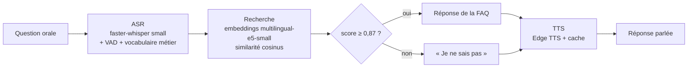

# Assistant vocal de FAQ

[](https://github.com/khadijagueye235/Assistant-vocal-de-FAQ/actions/workflows/ci.yml)
[](https://colab.research.google.com/github/khadijagueye235/Assistant-vocal-de-FAQ/blob/main/notebooks/demo_colab.ipynb)
[](LICENSE)

On pose une question **à l'oral** sur les transferts d'argent au Sénégal.
L'assistant la transcrit, retrouve la question la plus proche dans une FAQ de
30 entrées (tirée des pages publiques de Western Union) et lit la réponse à voix
haute. S'il n'est pas assez sûr de lui, il dit « je ne sais pas » et renvoie
vers le service client plutôt que d'inventer.

Projet du cours *IA Voix et Vidéo*. Il n'est pas affilié à Western Union.

## Fonctionnement



| Étape | Choix | Pourquoi |
|---|---|---|
| ASR | faster-whisper `small`, VAD, prompt avec le vocabulaire métier | Le prompt fait baisser de 40 % les erreurs sur les mots locaux (MTCN, Western Union, Wave) |
| Recherche | `multilingual-e5-small`, index question + réponse, requête normalisée | Meilleur top1 et meilleure séparation FAQ / hors FAQ parmi 4 modèles comparés |
| Seuil | 0,87, calibré par une fonction d'utilité | Une réponse fausse dite avec assurance coûte plus cher qu'un refus |
| TTS | Edge TTS (voix Denise) + cache des 32 messages possibles | Chaque requête coûte environ 1 s fixe ; les réponses étant fixes, le cache ramène le TTS à moins d'1 ms |

## Résultats (jeu de développement)

| Mesure | Texte écrit | Audio (8 voix synthétiques) |
|---|---|---|
| Bonne question classée 1re (top1) | 82 % | 77 % |
| Taux d'erreur sur les mots de l'ASR | — | 11 % (wolof : 37 %) |
| Questions hors FAQ refusées | 13 / 15 | 13 / 15 |

| Latence par question | GPU T4 (Colab) | CPU (PC portable) |
|---|---|---|
| ASR | 0,3 à 0,4 s | environ 2 s |
| Recherche | environ 15 ms | environ 15 ms |
| TTS (cache) | < 1 ms | < 1 ms |

Ces chiffres viennent du jeu de **développement**, celui sur lequel le système a
été réglé : ils sont optimistes. La mesure de référence se fait sur un jeu de
test séparé de 30 questions enregistrées par des personnes extérieures
(`data/audio_test/`), jamais utilisé pour le réglage.
<!-- C : ajouter ici les résultats du jeu de test (taux de bonnes réponses, latences médiane et p95). -->

## Démarrer

**Le plus simple :** le bouton *Ouvrir dans Colab* ci-dessus (choisir un GPU T4).

**En local** (Python 3.10 ou plus, [ffmpeg](https://ffmpeg.org/) installé) :

```bash
python -m venv .venv && source .venv/bin/activate   # Windows : .venv\Scripts\activate
pip install torch --index-url https://download.pytorch.org/whl/cpu   # sans GPU NVIDIA
pip install -r requirements-dev.txt
python -m pytest -q
```

```python
from src.pipeline import prechauffer, repondre

prechauffer()  # une fois : charge les modèles et prépare les voix
r = repondre("ma_question.m4a")  # chemin, tableau numpy ou tuple de gr.Audio
print(r.transcription, r.id_question, r.reponse_texte, r.latences)
```

Le contrat complet de `repondre()` est dans [docs/contrat_repondre.md](docs/contrat_repondre.md).
<!-- C : ajouter ici le lancement de l'interface Gradio. -->

## Structure

```
src/
  config.py      réglages (tous remplaçables par variable d'environnement)
  asr.py         audio -> texte (faster-whisper)
  search.py      texte -> question de la FAQ (embeddings)
  tts.py         texte -> audio (Edge TTS + cache)
  pipeline.py    repondre() : assemble les trois étapes, mesure les latences
scripts/         comparaison des modèles, calibration du seuil, jeu de dev audio
data/            FAQ, jeux de développement et de test (voir data/LISEZMOI.md)
results/         résultats des évaluations (CSV)
notebooks/       démonstration Colab
tests/           tests automatiques (pytest)
docs/            contrat de repondre(), étude de latence du TTS
```

## Démarche

Chaque choix a été mesuré avant d'être adopté, et les mesures sont versionnées :

- **Choix du modèle de recherche** : 4 modèles × 2 index × 2 prétraitements
  (`scripts/evaluer_recherche.py`, `results/evaluation_recherche.csv`).
- **Seuil « je ne sais pas »** : calibré par une fonction d'utilité sur le jeu
  de dev ; on retient le milieu d'un plateau plutôt que le maximum brut, qui
  est bruité (`scripts/calibrer_seuil.py`).
- **Jeu de dev audio** (`scripts/generer_dev_audio.py`, `scripts/evaluer_dev_audio.py`) :
  il a révélé que la majuscule et la ponctuation ajoutées par Whisper faisaient
  perdre 12 points de top1 à la recherche, corrigé en normalisant la requête.
- **Questions confondues** : 17 questions reformulées pour se distinguer de
  leurs voisines, en cherchant systématiquement les régressions (`data/LISEZMOI.md`).
- **TTS phrase par phrase** : étudié, puis écarté au profit d'un cache, chiffres
  à l'appui ([docs/latence_tts.md](docs/latence_tts.md)).

## Limites connues

- **Wolof** : Whisper ne connaît pas cette langue. Les questions qui mélangent
  wolof et français sont mal transcrites (37 % d'erreurs sur les mots).
  L'assistant les refuse le plus souvent plutôt que de mal répondre.
- **Questions proches dans la FAQ** : « retirer de l'argent » (n°23) et
  « documents pour le retrait » (n°30) restent difficiles à distinguer.
- **Voix synthétiques** : le jeu de dev audio articule mieux qu'un humain ;
  seul le jeu de test enregistré par de vraies personnes fait foi.
- Le TTS nécessite une connexion Internet. Sans réseau, la réponse s'affiche
  sans voix.

## Qualité

- Tests automatiques (pytest) : 69 tests, dont 57 rapides, lancés à chaque push
  par GitHub Actions avec ruff (style).
- Les tests qui chargent un modèle (marqueur `modele`) ou appellent Edge TTS
  (marqueur `reseau`) tournent en local ou sur Colab.

## Équipe

| Rôle | Responsabilité |
|---|---|
| A | Pipeline : ASR, recherche, TTS, évaluation sur le jeu de dev |
| B | Données et mesures : FAQ, jeu de test oral, mesures finales |
| C | Interface Gradio et documentation |
<!-- Ajouter les noms. -->

## Licence

Code sous licence [MIT](LICENSE). Le contenu de la FAQ reste la propriété de
Western Union (source de chaque réponse dans `data/faq.csv`).
